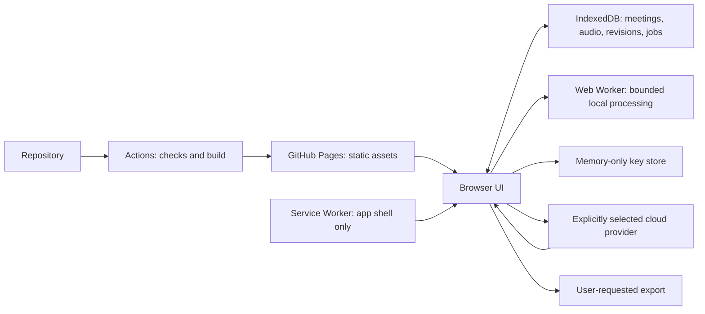

# Browser architecture

Status: browser implementation exists, 2026-11-04. The contracts below include original design intent; this implementation uses a versioned meeting aggregate plus a separate audio store. Read [feasibility](FEASIBILITY.md) for evidence and unresolved provider support.

## Execution and ownership

GitHub Pages serves only the static app shell and bundled assets. The browser owns local meeting state, calls explicitly selected providers, and stores returned results. GitHub Actions builds and deploys assets; it never processes a user's recording or supplies their provider credential.



Keep source recordings and meeting data out of Pages artifacts, Git, telemetry, and service-worker response caches. Storing user-approved meeting data in IndexedDB is a deliberate product function; it is different from indiscriminately caching network responses.

## Stack and modules

The implementation uses React/TypeScript/Vite, npm with a locked dependency tree, Zod validation, idb repositories, and a custom prompt-based app-shell worker. No application server is required. The original feature folders below map to the current `src/features/*.tsx` screens; domain, storage, providers, jobs, audio and PWA responsibilities are separate modules.

| Proposed module | Responsibility |
| --- | --- |
| `src/features/meetings/` | Library, metadata, import, deletion |
| `src/features/review/` | Speaker/transcript corrections and undo |
| `src/features/memo/` | Versioned memo generation and review |
| `src/domain/` | IDs, schema validation, provenance, revisions, stale rules |
| `src/storage/` | IndexedDB transactions, migrations, backup/restore |
| `src/providers/` | Explicit provider contracts, normalization, cost and errors |
| `src/jobs/` | Foreground scheduler, checkpoints, billing uncertainty |
| `src/audio/` | Playback and bounded decode/encode workers |
| `src/pwa/` | Install, connectivity, worker update UX |

Prefer two small initial integrations over a universal plugin framework: one browser-validated speech provider and one memo provider. The speech integration must prove speaker/time capability before release. The same provider can serve both roles only when its contracts support them.

## Provider boundary

Record capabilities per model/endpoint rather than treating every transcription service as interchangeable:

- Accepted containers/codecs and request size/duration limits.
- Text, turn/word timestamps, anonymous speakers, overlap, and channel support.
- Language hints and domain terminology support.
- Synchronous/streamed versus durable asynchronous job behavior.
- Request IDs, polling, cancellation, idempotency, rate limits, and pricing basis.
- Browser CORS and response-header visibility verified for the exact production origin.

Normalize output into internal evidence records while retaining the provider/model/configuration and sanitized original payload. Missing timestamps stay `null`; never distribute text uniformly over time or ask the memo model to invent alignment. A browser CORS failure disables that integration; it does not trigger an undisclosed proxy.

Support importing an evidence-bearing transcript as a separate route. A text-only import remains text-only until a real mapping is supplied.

## Data contract

Use UUIDs, explicit schema/source/storage versions, finite second-based audio times, and validated imports. `src/domain/model.ts` is the authoritative shipped schema; the record table below explains logical responsibilities rather than separate database tables.

| Record | Core fields and invariants |
| --- | --- |
| `Meeting` | `id`, title, date, timezone, languages, template, `revision`, `schemaVersion` |
| `AudioAsset` | `id`, meeting ID, filename, MIME/codec, bytes, duration, content hash, channel metadata, persistence state |
| `ProviderRun` | `id`, provider, model, capability snapshot, sanitized configuration, audio hash, chunk ID, original result, timestamps; no key |
| `Speaker` | `id`, meeting ID, display name, identity state, source labels scoped by run/chunk |
| `SegmentRevision` | stable segment ID, revision, audio ID, nullable start/end, speaker IDs, original/edited text, timing origin, assignment/review state, parent revision refs |
| `ReviewOperation` | operation ID, affected revisions, before/after refs, undo state; committed with the change |
| `MemoVersion` | version ID, meeting/source revision, generation run, preserved human edits |
| `MemoItem` | item ID/type/text, nullable owner/date, original date wording, source `(segmentId, revision)` refs, review state |
| `ProcessingJob` | job/chunk IDs, stage, state, provider run, attempts, input hash, sanitized request ID, estimate, billing state, checkpoint |

Original provider results are immutable. Current transcript views project those results plus human revisions. Splitting or merging preserves lineage, so an old citation can still resolve to its original revision while being visibly stale.

Start with a conservative invalidation rule: text, assignment, speaker identity, date, or timezone changes increment the meeting source revision and mark generated memo items for re-review. More selective invalidation can follow with tests. New generations never overwrite an accepted human version.

Source IDs establish traceability, not semantic correctness. Independently validate that references exist, belong to the meeting, and use the expected revisions; users still review whether a claim follows from them.

## Storage and transaction rules

IndexedDB is the P0 source of truth. Structured records are stored as one versioned meeting aggregate, while encoded audio bytes and media type are stored separately by meeting ID. File-to-buffer conversion happens before database transactions, avoiding a reproduced WebKit File/Blob persistence failure. Playback reconstructs a Blob. One original audio hash is retained per meeting; rebinding a different recording is rejected. Keep provider responses outside Cache Storage. Add OPFS only if measurements justify its extra coordination and recovery costs.

- Save a completed chunk and its job checkpoint in one transaction before scheduling the next chunk.
- Save an edit and its undo operation together. Use expected revisions and a writer lease to prevent stale multi-tab writes.
- Perform network, hashing, and audio work outside live IndexedDB transactions. Use short database-only transactions and test them in actual Chromium/WebKit.
- Check estimated usage and request persistent storage where supported. Handle denial and quota failure without silently deleting existing meetings.
- Imported files have resource bounds, schema validation, collision handling, and a preview before replacing data. Imported credentials are rejected.
- Backup/restore includes schema version, manifest, audio references/hashes, revisions, and jobs. Mark absent audio explicitly.
- Namespace storage and remove only this application's named records/caches. A repository path is not a security boundary; see [deployment](DEPLOYMENT.md).

Future asynchronous file storage would need explicit pending/ready states and orphan cleanup because IndexedDB and file storage cannot share one atomic transaction.

## Foreground job and billing state

Use a small foreground scheduler with bounded concurrency and Web Locks where available, plus a transactional lease fallback for supported browsers. Locks protect local scheduling; they cannot prevent provider-side duplicate charging.

Persist intent before initiating a request. Distinguish these states:

```text
queued -> preparing -> ready_to_send -> in_flight -> completed
                           |              |
                           |              +-> outcome_unknown
                           +-> failed_before_send
queued/ready_to_send -> paused
in_flight -> cancel_requested -> cancelled_or_unknown
```

After a crash, an `in_flight` checkpoint becomes `outcome_unknown`, including the window between actual submission and local acknowledgement. A provider's durable job ID allows polling the same job. If no such ID was recorded, do not assume the request never ran.

Billing state is separate: `not_submitted`, `possibly_charged`, `provider_reported`, or `unknown`. Local cancellation stops waiting/scheduling but does not prove remote processing or billing stopped.

Disable SDK automatic retries for paid submissions, then implement explicit error policy. Safe status polling can retry with bounded backoff. A documented refusal before execution can be offered for retry; ambiguous timeouts/disconnects need user review. Do not treat a client-generated idempotency key as provider-supported exactly-once execution.

On reload, keys are missing by design. Re-entry and file re-selection are recovery states, not lost-work errors. Partial streamed text stays provisional until final completion and validation; never mark it complete after a broken stream.

## Audio handling

Keep encoded source audio for playback with object URLs and revoke URLs on release. Do not decode an entire long recording merely to show duration or draw a waveform.

The beta uploads one original recording up to 50 MB and computes its checksum in a worker; conversion and multi-chunk transcription are deferred. Valid future chunking requires container-aware processing or bounded decode/re-encode. `Blob.slice()` over arbitrary MP3/M4A/WebM bytes is not an independent playable file. Preserve source offsets, encoder delay where relevant, and boundary provenance. Handle overlapping transcription windows with a documented boundary reconciliation algorithm; text similarity alone must not delete genuinely repeated speech.

Prefer one provider request for the whole recording when its verified limits permit it, preserving global speaker clustering. Otherwise scope labels by run/chunk and require evidence-based mapping. Preserve isolated channels before any downmix; multiple people can still share one channel.

Use a single-thread browser processing fallback. WASM, WebCodecs, and supported codecs require device-specific verification; do not make cross-origin-isolated multithreaded WASM a baseline requirement on Pages. Limit work, offer cancellation, and explain unsupported large inputs.

## Memo generation

Send the reviewed transcript and only needed metadata. Treat transcript content as data, including any embedded instructions. The memo generator has no tools that send messages, write ERP records, or follow links.

Validate structured responses, handle refusal and truncation, and require nullable unknown fields. The beta rejects serialized memo input above 80,000 characters before transmission. Future long-input support must use evidence-preserving bounded extraction then synthesis: carry original segment IDs through every stage and recheck contradictions against source text. Count all stages in the estimate.

## Keys and network destinations

Keep keys in a non-persisted memory store; exclude them from state snapshots, URLs, logs, exports, and error reports. Clear on explicit forget and page termination as far as the browser allows; do not claim forensic memory erasure. Persistence is deferred from P0.

Provider selection controls the allowed HTTPS destination, key namespace, and `connect-src` policy. Never reuse one provider's key against another endpoint or auto-follow an unexpected credential-bearing redirect. Custom endpoints are a separately reviewed capability, not a default free-text URL.

Bundle runtime scripts locally, avoid trackers and remote script CDNs, render imported/generated text safely, and sanitize any supported Markdown. Browser BYOK necessarily trusts the app's code and its origin.

## PWA lifecycle

Cache a bounded, versioned app shell under this project's path. Intercept only same-origin app assets/navigation in scope; let provider requests bypass caching. Clone a response before asynchronous cache writes if a custom caching handler is needed.

Use network/revalidation for HTML and content-hashed static assets for immutable caching. Configure worker update discovery and test actual Pages headers. Clean only this app's obsolete cache names and retain assets needed by still-running clients.

The update flow is: detect waiting worker, notify, save edits, settle active submissions or expose a safe pause, user clicks update, show progress, activate, wait for controller change, reload. Provide timeout/error recovery. Coordinate database migrations and old tabs before schema changes. Never auto-reload while reviewing or processing a meeting.

## Optional extensions

Local pyannote, self-hosted models, and persistent server jobs are separate future deployment modes. Adding one must document origin/authentication, data destination, installation, and state ownership. Failure of a direct browser provider is not authorization to introduce a mandatory backend.
