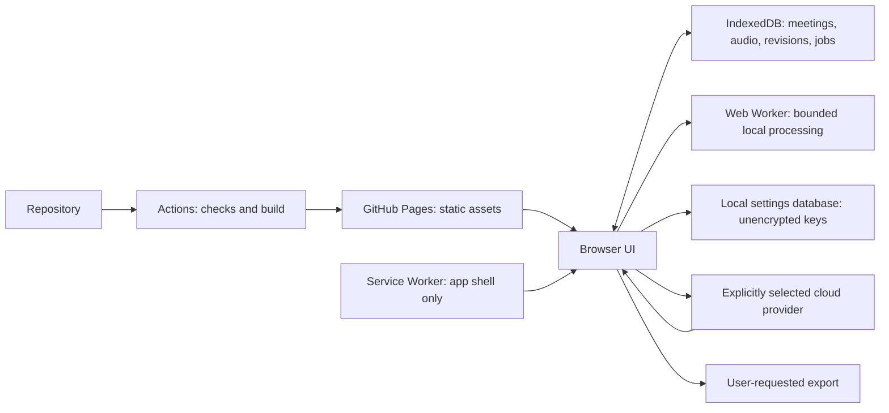

# Browser architecture

> Owner direction, 2026-11-17: [../goal.md](../goal.md) and the [quality-first implementation plan](QUALITY-FIRST-PLAN.md) define the Pi-orchestrated, multi-model target. Existing behavior below remains the current/dated implementation record. QF01 removes fixed cumulative review budgets while retaining progress/recovery guards; the full router, coverage and independent-review workflow are not yet implemented. See the validation record for verified delivery stages.

Status: browser implementation exists, 2026-11-04. The contracts below include original design intent; this implementation uses a versioned meeting aggregate plus a separate audio store. Read [feasibility](FEASIBILITY.md) for evidence and unresolved provider support.

## Execution and ownership

GitHub Pages serves only the static app shell and bundled assets. The browser owns local meeting state, calls explicitly selected providers, and stores returned results. GitHub Actions builds and deploys assets; it never processes a user's recording or supplies their provider credential.



Keep source recordings and meeting data out of Pages artifacts, Git, telemetry, and service-worker response caches. Storing user-approved meeting data in IndexedDB is a deliberate product function; it is different from indiscriminately caching network responses.

The [acoustic speaker continuity contract](ACOUSTIC-SPEAKER-CONTINUITY.md) covers automatic identity association across long-recording parts. Local acoustic matching and checkpoints are implemented behind explicit consent, but labelled accuracy, deployed model recovery and physical-device acceptance remain open. See [handoff](HANDOFF.md); do not treat matching labels or overlapping words as voice evidence.

## Stack and modules

The implementation uses React/TypeScript/Vite, npm with a locked dependency tree, Zod validation, idb repositories, and a custom prompt-based app-shell worker. No application server is required. Feature screens are in `src/features/*.tsx`; domain, storage, providers, jobs, audio and PWA responsibilities are separate modules.

| Module | Responsibility |
| --- | --- |
| `src/App.tsx`, `src/features/NewMeeting.tsx` | Library, navigation, creation and import |
| `src/features/MeetingWorkspace.tsx`, `src/features/SpeakerReview.tsx` | Meeting, transcript and speaker review, corrections and undo |
| `src/features/MeetingWorkspace.tsx`, `src/features/CitedEvidence.tsx` | Versioned notes and evidence review |
| `src/domain/` | IDs, schema validation, provenance, revisions, stale rules |
| `src/storage/` | IndexedDB transactions, migrations, backup/restore |
| `src/providers/` | Explicit provider contracts, normalization, cost and errors |
| `src/jobs/` | Foreground scheduler, checkpoints, billing uncertainty |
| `src/audio/` | File inspection, container-aware splitting, bounded playback/voice decoding, model worker and checksum support |
| `src/pwa/` | Install, connectivity, worker update UX |
| `src/components/ui.tsx` & `src/style.css` | Single Source of Truth (SSOT) Design System tokens, primitives (`Modal`, `Pill`, `Empty`, `Brand`), speaker palette, and responsive layout rules |

Prefer two small initial integrations over a universal plugin framework: one browser-validated speech provider and one memo provider. The speech integration must prove speaker/time capability before release. The same provider can serve both roles only when its contracts support them.

## Provider boundary

Record capabilities per model/endpoint rather than treating every transcription service as interchangeable:

- Accepted containers/codecs and request size/duration limits.
- Text, turn/word timestamps, anonymous speakers, overlap, and channel support.
- Language hints and domain terminology support.
- Synchronous/streamed versus durable asynchronous job behavior.
- Request IDs, polling, cancellation, idempotency, rate limits, and pricing basis.
- Browser CORS and response-header visibility verified for the exact production origin.

Normalize output into internal evidence records while retaining the provider/model/configuration and sanitized original payload. Missing timestamps stay `null`; never distribute text uniformly over time or ask the memo model to invent alignment. A browser CORS failure disables that integration; it does not trigger an undisclosed proxy.

Support importing an evidence-bearing transcript as a separate route. A text-only import remains text-only until a real mapping is supplied.

## Data contract

Use UUIDs, explicit schema/source/storage versions, finite second-based audio times, and validated imports. `src/domain/model.ts` is the authoritative shipped schema; the record table below explains logical responsibilities rather than separate database tables.

| Record | Core fields and invariants |
| --- | --- |
| `Meeting` | `id`, title, date, timezone, languages, template, `revision`, `schemaVersion` |
| `AudioAsset` | `id`, meeting ID, filename, MIME/codec, bytes, duration, content hash, channel metadata, persistence state |
| `ProviderRun` | `id`, provider, model, capability snapshot, sanitized configuration, audio hash, chunk ID, original result, timestamps; no key |
| `Speaker` | `id`, meeting ID, display name, identity state, source labels scoped by run/chunk |
| `SegmentRevision` | stable segment ID, revision, audio ID, nullable start/end, speaker IDs, original/edited text, timing origin, assignment/review state, parent revision refs |
| `ReviewOperation` | operation ID, affected revisions, before/after refs, undo state; committed with the change |
| `MemoVersion` | version ID, meeting/source revision, model, separate `originalItems` snapshot and editable `items`; older backups may lack the snapshot |
| `MemoItem` | item ID/type/text, nullable owner/date, original date wording, source `(segmentId, revision)` refs, review state |
| `ProcessingJob` | job/chunk IDs, stage, state, provider run, attempts, input hash, sanitized request ID, estimate, billing state, checkpoint |

Original provider results are immutable. Current transcript views project those results plus human revisions. Splitting or merging preserves lineage, so an old citation can still resolve to its original revision while being visibly stale.

Each new memo version clones the normalized generated items into `originalItems` before human review. Text/owner/date/review edits change only `items`; JSON and full backups retain both. The UI exposes the original text and fields. Existing v1 backups without originals remain readable and explicitly report that the original was not saved; it cannot be inferred from corrected text. The field is optional for old-backup compatibility. Older app builds may reject new optional fields, so update open tabs before editing newly created memo data; a refused old-client read must never trigger deletion or a lossy rewrite.

Start with a conservative invalidation rule: text, assignment, speaker identity, date, or timezone changes increment the meeting source revision and mark generated memo items for re-review. More selective invalidation can follow with tests. New generations never overwrite an accepted human version.

Memo review actions commit the displayed text, owner, due date, review state and reviewed source revision together. An item-scoped interaction guard suppresses competing blur saves until that review commit finishes; repository version checks remain authoritative for real stale-tab conflicts. Mouse focus prevention and touch default-click behavior differ. Touch interaction completion at Window/null must not be confused with explicit cancellation or departure to another element. Generated originals are never changed by a review commit.

Source IDs establish traceability, not semantic correctness. Independently validate that references exist, belong to the meeting, and use the expected revisions; users still review whether a claim follows from them.

## Storage and transaction rules

IndexedDB is the P0 source of truth. Structured records are stored as one versioned meeting aggregate, while encoded audio bytes and media type are stored separately by meeting ID. File-to-buffer conversion happens before database transactions, avoiding a reproduced WebKit File/Blob persistence failure. Playback reconstructs a Blob. One original audio hash is retained per meeting; rebinding a different recording is rejected. Keep provider responses outside Cache Storage. Add OPFS only if measurements justify its extra coordination and recovery costs.

- Save a completed chunk and its job checkpoint in one transaction before scheduling the next chunk.
- Save an edit and its undo operation together. Use expected revisions and a writer lease to prevent stale multi-tab writes.
- Perform network, hashing, and audio work outside live IndexedDB transactions. Use short database-only transactions and test them in actual Chromium/WebKit.
- Check estimated usage and request persistent storage where supported. Handle denial and quota failure without silently deleting existing meetings. Settings has a read-only storage monitor (`src/storage/storage-report.ts`, `src/features/StorageMonitor.tsx`) that shows the browser's usage estimate and persistence state, and per meeting the size of its document (by section), recording, voice data and images against the meeting size limit. It reads only this app's meeting database, never settings or keys, and changes nothing. Sizes are JSON-text estimates; the browser total also counts other apps on the shared origin, the speaker model and caches.
- Imported files have resource bounds, schema validation, collision handling, and a preview before replacing data. Imported credentials are rejected.
- Backup/restore includes the meeting aggregate, audio references/hashes, revisions, and jobs; ordinary audio and supported avatars can be included. Chunked audio and separate per-chunk speech/acoustic stores are not included. Mark absent audio explicitly and do not assume interrupted chunk progress is recoverable from the archive alone; see REC01–03 in [tasks](../task.md).
- Namespace storage and remove only this application's named records/caches. A repository path is not a security boundary; see [deployment](DEPLOYMENT.md).

Future asynchronous file storage would need explicit pending/ready states and orphan cleanup because IndexedDB and file storage cannot share one atomic transaction.

## Foreground job and billing state

Use a small foreground scheduler with bounded concurrency and Web Locks where available, plus a transactional lease fallback for supported browsers. Locks protect local scheduling; they cannot prevent provider-side duplicate charging.

Persist intent before initiating a request. Distinguish these states:

```text
queued -> preparing -> ready_to_send -> in_flight -> completed
                           |              |
                           |              +-> outcome_unknown
                           +-> failed_before_send
queued/ready_to_send -> paused
in_flight -> cancel_requested -> cancelled_or_unknown
```

After a crash, an `in_flight` checkpoint becomes `outcome_unknown`, including the window between actual submission and local acknowledgement. A provider's durable job ID allows polling the same job. If no such ID was recorded, do not assume the request never ran.

Billing state is separate: `not_submitted`, `possibly_charged`, `provider_reported`, or `unknown`. Local cancellation stops waiting/scheduling but does not prove remote processing or billing stopped.

Disable SDK automatic retries for paid submissions, then implement explicit error policy. Safe status polling can retry with bounded backoff. A documented refusal before execution can be offered for retry; ambiguous timeouts/disconnects need user review. Do not treat a client-generated idempotency key as provider-supported exactly-once execution.

Saved keys and settings are restored from the separate local settings database before the app renders. Re-entry is needed after the first upgrade from a memory-only build or after forgetting/clearing site data. File re-selection is intended as a recovery path, but the current long-recording identity check rejected an identical file after restore in synthetic local Chromium/WebKit checks; a repair and physical-device verification remain open. Partial streamed text stays provisional until final completion and validation; never mark it complete after a broken stream.

## Audio handling

Keep encoded source audio for playback with object URLs and revoke URLs on release. Do not decode an entire long recording merely to show duration or draw a waveform.

### Playback synchronization boundary

The owner-approved playback redesign uses the existing persistent audio element as the media clock, with one shared snapshot for position and playback status. Presentation can read that snapshot frequently without advancing time independently or writing meeting revisions. `currentTime` also represents the selected position while paused; a matching source interval is attribution at that position, not proof of active speech. Media events remain important for seek, pause, rate, buffering, end and error transitions. See the browser contracts for [currentTime](https://developer.mozilla.org/en-US/docs/Web/API/HTMLMediaElement/currentTime) and [timeupdate](https://developer.mozilla.org/en-US/docs/Web/API/HTMLMediaElement/timeupdate_event).

`src/features/usePlaybackClock.ts` owns the media-event snapshot, including sticky buffering state and a synchronous `refresh()` after an explicit application seek. The latter reads the actual media position before a controlled range input can restore an old value between rapid keyboard steps; it does not predict the requested time. `src/domain/playback.ts` owns read-only caption grouping, exact source-interval matching and the nearest-time view anchor. `SpeakerReview` presents Playback/Edit Speakers modes, while `MeetingWorkspace` retains the persistent audio element, cue boundaries and video exclusion token.

During visible playback, a cancellable animation-frame loop samples the actual media time on each frame. It stops on pause, buffering, end, error, hidden document and cleanup; media events retain seek/background handling and restart sampling on resume. Boundary-based subscribers only render when their projected interval changes, and the player controls still use coarse position updates. The frame loop never advances a separate clock or corrects provider timestamps. Browser frame rates, media clock precision and output devices still affect perceived synchronization.

Caption grouping and active-speaker/transcript projection belong to the read layer. The authoritative evidence stays in original segment IDs, revisions, text, speaker arrays and nullable time ranges. Group envelopes must not turn an internal gap into attributed speech. A gap of at most 350 ms inside an existing same-speaker caption group may retain readable context, explicitly labeled "Between words / context only" with no speech halo, active-speaker flag or transcript highlight. It does not extend source intervals, bridge different speakers or change seeking. Overlapping source intervals may produce several active speakers and caption rows. Unknown timing never receives an interpolated range. Playback headings remain stable; naming/confirmation belongs to Edit Speakers. Rapid source-label alternation still requires attribution review rather than identity guessing or automatic merging.

Playback following is view state, separate from memo-citation selection and correction state. Manual transcript browsing pauses following; resuming follow does not move keyboard focus. Bounded rendering must preserve navigation to every group and the existing source-inspection/editing paths. Player controls, sample cues, evidence cues and reference-video mutual exclusion retain a single audio owner. Photos or reference metadata, if added later, remain presentation metadata and must not enter provider prompts implicitly.

`ImmersivePlayback` is a presentation view over the existing player and `PlaybackClockStore`; `MeetingWorkspace` continues to own playback commands, cue state and reference-video exclusion. Fullscreen state, fallback, focus restoration, caption size and transcript navigation are local view state. The immersive view uses the existing read-only caption and timing projections and does not change meeting evidence. Native fullscreen and physical-device behavior remain browser-dependent and require device acceptance.

The local immersive follow-up renders attributed speakers at the current position separately from a collapsible list of all speaker labels. It reads name-confirmation status from the meeting and shows active-speech emphasis only during playback; an unknown attribution remains explicit. Caption emphasis uses the existing exact fragment intervals. Untimed text is a separate disclosure with its own pagination. These presentation changes do not link part-scoped speakers or alter the shared player or source records.

When no source interval is active, the immersive stage retains short within-caption context or the most recently completed timed caption, labeling it as context or a previous caption rather than current speech. It derives this from the current media position, so backward seeks do not retain a future speaker. Before the first timed caption it shows no invented prior content.

Immersive transcript width, search, follow and Focus/Reading mode are transient view state. Search filters all locally available caption groups and untimed segments; only timed results can seek. Returning to playback clears the filter, restores follow and retains keyboard focus. The responsive sheet and stage shortcuts issue existing player commands; neither mode nor viewport changes alter evidence, speaker identities or playback state.

#### Group-chat playback and audio-reactive avatar architecture

The group-chat playback stage derives all visual synchronization from `HTMLAudioElement.currentTime` as the single source of truth:

```text
Audio.currentTime
   |
   v
Find active transcript segment
   |
   +-- Speaker ID     -> Active Avatar (top speaker stage card + bubble avatar badge)
   +-- Time range     -> Active Chat Bubble (150-200ms soft-green surface/border transition)
   +-- Word timing    -> Caption Highlight (fragment-level when fragments.length > 1, else sentence-level)
   +-- Audio analyser -> Avatar Pulse (bounded 1.00-1.12 scale when playing && active)
```

Module responsibilities for this pipeline:

- **`src/domain/playback.ts` (`PlaybackCaption.fragments` preservation)**: Consecutive short segments from the same speaker (`gap <= 350 ms`, up to `220` characters) merge into a single `PlaybackCaption` bubble for readability while preserving an ordered `fragments` array (`id`, `start`, `end`, `speakerIds`, `text`, `untimed`). Active state at `currentTime` resolves both the active bubble (`activeCaptions`) and the active sub-segments (`activeSegmentIds`) so `SpeakerReview` can render word/phrase-level highlighting when provider responses include sub-sentence timestamps (`fragments.length > 1`) and sentence-level highlighting when only sentence timestamps exist (`fragments.length === 1`), without character-count time interpolation.
- **`src/audio/playback-energy.ts` (Web Audio energy boundary)**: A lazy shared `AudioContext` connects the current media element to a separate `AnalyserNode` (`fftSize = 512`) and samples time-domain audio into a reused array. Smoothed aggregate recording energy drives a bounded decorative halo only for source-attributed active speakers; it does not isolate a person's volume. `src/features/usePlaybackClock.ts` owns the separate media-clock sampling. Unavailable Web Audio and reduced motion fall back without claiming speaker energy. See [playback energy](PLAYBACK-ENERGY.md).
- **`src/features/SpeakerReview.tsx` (Sequential group-chat stream)**: Render the meeting's speaker roster and a chronological, left-aligned group-chat stream. Clicking a timed bubble seeks the shared player. Manual scrolling pauses following and exposes **Follow playback**; untimed text has no fabricated seek position.

The current import path routes files over 24,000,000 bytes through container-aware MP3/MPEG or supported M4A/MP4 splitting, with a 4 GiB configured ceiling and a 25,000,000-byte per-request speech limit. Other large formats require external conversion; fragmented MP4 has additional restrictions documented in the README. These are code limits, not measured phone capacities. Chunks, offsets and overlapping lead-ins are stored locally and submitted sequentially after confirmation. Arbitrary MP3/M4A/WebM byte slices are not independently playable files; preserve offsets and boundary provenance, and never use text similarity alone to establish voice identity. Chunked backup/reattachment currently has the open REC01–03 limitations in [tasks](../task.md).

Prefer one provider request for the whole recording when its verified limits permit it, preserving global speaker clustering. Otherwise scope labels by run/chunk and require evidence-based mapping. Preserve isolated channels before any downmix; multiple people can still share one channel.

Use a single-thread browser processing fallback. WASM, WebCodecs, and supported codecs require device-specific verification; do not make cross-origin-isolated multithreaded WASM a baseline requirement on Pages. Limit work, offer cancellation, and explain unsupported large inputs.

## Memo generation

Send the reviewed transcript and only needed metadata. Treat transcript content as data, including any embedded instructions. The memo generator has no tools that send messages, write ERP records, or follow links.

Generation instructions request independently checkable claims whose numbers, conditions, entities and qualifiers are completely supported by their selected passages. Claims that need different evidence must be split; unsupported details must be omitted, and uncertainty must come from the transcript. These are generation instructions, not a semantic proof: actual model output can still cite incomplete evidence. Keep new items pending and compare every clause with the selected source text before accepting it. Human corrections change editable items while retaining generated originals.

Validate structured responses, handle refusal and truncation, and require nullable unknown fields. `src/providers/memo-input.ts` owns the 80,000-character serialized per-request limit. `memo-plan.ts` selects the existing single-request path or a bounded multi-stage plan; preflight and submission use the same builder. Inputs that already fit retain their original segment IDs. Larger inputs group consecutive segments only when their ordered speaker assignments match, with at most 20 original segments per transport group. The builder retains all text and a request-local map from compact IDs to original IDs and revisions; it does not modify stored segments, timestamps, speakers, history or normalized runs. A compact response may cite at most five groups per item, which are expanded, revision-validated and deduplicated before persistence within the existing 100-source limit. Unknown groups or invalid references reject the result. Compact IDs are never persisted as evidence references.

Compact group text is an ordered array of the original fragments, preserving each fragment's exact content and boundaries without claiming what whitespace belongs between them. Speaker entries use zero-based indices into the accompanying speaker list, falling back to the original ID if it is absent. The request instructs the model not to infer exact values from ambiguous boundaries and to return actual speaker IDs for owners. The complete serialized input must still fit 80,000 characters after grouping; otherwise preflight rejects it without a request. This existing single-request compaction preserves metadata and text; the separately confirmed multi-stage path below handles larger transcripts. Output remains capped at 8,000 tokens. Any future extraction/synthesis pipeline must preserve original evidence through every stage, recheck contradictions and include every paid stage in the estimate.

### Bounded multi-stage memo execution

`src/providers/memo-plan.ts` packs at most eight extraction requests, retaining each original as one core source and the preceding complete fragment as boundary context. It freezes source metadata/revisions and provider/model. Each extraction is normalized through the existing memo contract; full cited fragments are attached locally as exact quotations, not model-invented excerpts. The complete items-plus-quotes checkpoint must fit 8,000 serialized characters. Synthesis carries all checkpoints, must fit 80,000 characters, cites candidate item IDs and expands them to original source revisions. Excessive data, invalid references, refusal or incomplete responses stop rather than truncate or trigger recursive requests. Structural checks do not establish semantic support.

`src/jobs/memo-pipeline.ts` owns the sequential foreground execution, per-step intent and atomic result/checkpoint saves. Each paid attempt is a normal Job with pipeline/step association; the parent is never a second charge. Intent is saved before networking; every new intent also checks competing active jobs. CAS remains authoritative with or without Web Locks. A successful step can be reused after explicit resume. A prior failed/unknown step requires the user's billing-review checkbox and a separately confirmed paid attempt. Completed results and previous failed attempts remain in history. Page reload never schedules work. New memo generation opens the memo view immediately to avoid repeatedly rendering a large correction editor for each checkpoint.

Meeting schema v2 stores pipeline snapshots/results in the existing aggregate and existing IndexedDB stores. v1 imports are accepted and normalized in memory, without writes on read. Older clients safely reject the new schema/fields; old stale writes still fail CAS. Exports are v2, credentials remain separate, and restored in-flight plans are blocked. New plans reserve history capacity for every request and reject a plan whose meeting document would exceed `MAX_MEETING_JSON_BYTES` (`src/domain/model.ts`, 64 MiB since 2026-11-16; it was a 10 MiB plan budget below a 12 MiB import cap). That one constant also bounds contextual suggestions, memo review writes, the backup `meeting.json` entry and JSON import. It is an application limit, not an IndexedDB limit: a meeting is saved, exported and restored as one in-memory JSON document, and a Chromium string holds about 512 MiB, so the limit stays well below that. The 120 MB total backup cap is unchanged. Real IndexedDB writes measured on one desktop: a 15 MB record took about 225 ms in Chromium and 462 ms in WebKit to write; phones were not measured. Original source snapshots must match current or historical meeting evidence. Final notes retain their captured source revision, generated originals and pending review, even if sources changed during execution. Forward fixes are preferred once v2 records exist.
The meeting schema remains v2 and accepts older records. IndexedDB version 3 adds `chunkSpeech`, keyed by meeting ID and chunk index; deleting a meeting removes these rows with its other recording data. Audio metadata may describe up to 4 GiB and 2,000 verified MP3/MP4 chunks. `runChunkedSpeech` records one paid-attempt Job per chunk, persists normalized chunk speech before completion accounting, stops after failures, and resumes only saved chunks; uncertain attempts require explicit review. The merged transcript replaces current evidence only when the captured revision remains current, otherwise it is stored in run history. This runner layer is not connected to the current UI.

## Keys and network destinations

Optional Pi selective review uses `memoAgents` in the existing v2 aggregate and `agentId`/`assistantRecord` job fields. Frozen snapshots hold source revision references; context links each decoded assistant record once and stores bounded tool artifacts. The core/Responses adapter is dynamically imported after explicit confirmation. `memo-agent.ts` owns the fetch-once boundary, three-round no-new-evidence guard, per-response tool burst limit, sequential read-only tools, durable receipts and validated final citations. It uses the existing processing controller and meeting lock; no worker/server or general Pi provider autodiscovery is involved. `agent-recovery.ts` retains key-redacted unsaved receipts and, for unsupported decoding, a bounded wire-response export. Recovery merges the receipt into the latest aggregate without replacing human edits or a newer plan. SDK usage placeholders and catalog prices are not provider evidence. See [the implementation contract and delivery limits](PI-MEMO-READINESS.md).

The user explicitly selected unencrypted local IndexedDB persistence for provider keys. Store settings separately from meeting records and restore them before requests; expose the shared-origin/browser-profile risk in Settings. Use atomic revision-checked writes to reject stale-tab saves, propagate changes to other tabs, and keep keys out of meeting snapshots, URLs, logs, exports, error reports, static artifacts and worker caches. Forgetting keys updates the stored record while preserving other preferences. Protect in-flight settings saves and unsaved settings when updating the PWA. Do not claim encryption or forensic memory erasure.

Provider selection controls the allowed HTTPS destination, key namespace, and `connect-src` policy. Never reuse one provider's key against another endpoint or auto-follow an unexpected credential-bearing redirect. Custom endpoints are a separately reviewed capability, not a default free-text URL.

Bundle runtime scripts locally, avoid trackers and remote script CDNs, render imported/generated text safely, and sanitize any supported Markdown. Browser BYOK necessarily trusts the app's code and its origin.

## PWA lifecycle

Cache a bounded, versioned app shell under this project's path. Intercept only same-origin app assets/navigation in scope; let provider requests bypass caching. Clone a response before asynchronous cache writes if a custom caching handler is needed.

Precache each release with `Request.cache="reload"` so fresh browser HTTP entries cannot supply old HTML. Serve navigations from the activated release's cached index, keeping HTML and its hashed assets together online and offline. Worker discovery bypasses HTTP caching and changes only through the explicit activation flow. Cache identity includes both assets and worker source. Clean only this app's obsolete cache names and retain one previous app cache for still-running clients. [Request cache modes](https://developer.mozilla.org/en-US/docs/Web/API/Request/cache), [Cache.addAll Request inputs](https://developer.mozilla.org/en-US/docs/Web/API/Cache/addAll)

The update flow is: detect waiting worker, notify, save edits, settle active submissions or expose a safe pause, user clicks update, show progress, activate, wait for controller change, reload. Provide timeout/error recovery. Coordinate database migrations and old tabs before schema changes. Never auto-reload while reviewing or processing a meeting.

## Optional extensions

Local pyannote, self-hosted models, and persistent server jobs are separate future deployment modes. Adding one must document origin/authentication, data destination, installation, and state ownership. Failure of a direct browser provider is not authorization to introduce a mandatory backend.

## SSOT Design System protocol

To prevent visual drift, duplicated hex literals, and conflicting status labels across screens, the UI architecture follows a four-layer Single Source of Truth (SSOT) Design System protocol:

1. **Layer 1 - Design tokens (`src/style.css` and `src/theme.css`)**:
   - Authoritative handwritten CSS is the project-local K1 adaptation. `src/style.css` owns base palette primitives, typography/font-size axes and five speaker background slots. `src/theme.css` owns base semantic roles and deliberate light/dark/palette overrides. An ownership contract rejects duplicate unscoped base declarations across the two files; scoped axis overrides are intentional. There is no JSON token source or generated CSS freshness claim.
   - `--color-accent` is the palette-dependent primary accent; `--color-accent-text` and `--color-focus` map palette values to their interaction roles. Existing numbered palette tokens remain in use elsewhere.
   - The green status pill uses `--status-green-bg` and `--status-green-text` as a pair that changes with light/dark theme, independently of the selected palette. Other status tones use their own background and text tokens.
   - Speaker backgrounds use `--speaker-1` through `--speaker-5`; the shared helper assigns slots by meeting presentation order, not voice identity.
2. **Layer 2 - UI primitives (`src/components/ui.tsx`)**: Shared primitives include `Brand`, `Pill`, `Modal`, and `Empty`; views also use shared CSS classes for controls and layout.
3. **Layer 3 - Shared workflow and speaker semantics**: Workflow status is projected centrally for meeting views. Speaker presentation uses the shared speaker background helper; its colors are separate from the selected appearance palette.
4. **Layer 4 — Viewport and Layout Contracts**:
   - Sticky `.topbar` uses a compact `52px` desktop (`56px` mobile) height with a clickable `.breadcrumb-root` link (`Workspace -> #/`) and in-context meeting status `<Pill>`.
   - Dashboard prioritizes above-the-fold task density (`Topbar -> Page Heading -> 3 Workflow KPI Cards -> Compact Welcome Banner -> Unified .library-toolbar -> Meeting Cards`).
   - Mobile viewports (`<= 720px`) enforce single-column stacking, `>= 16px` form controls (preventing iOS Safari auto-zoom), safe-area insets, and a persistent accessible bottom audio player.


### Static design-debt gate

`npm run check:ssot` runs `scripts/check-ssot.mjs` without changing source or its reviewed `scripts/ssot-baseline.json`. The publication workflow runs it before the build. Lightning CSS parses CSS and the TypeScript compiler parses TS/TSX; malformed input or baseline configuration fails the command. The scope is `src` CSS/TS/TSX plus the browser-chrome color in `index.html`, excluding dependencies, generated output and test fixtures.

The gate inventories raw colors, radius, shadow, font-size and z-index values, including supported static inline declarations. Root token custom properties in `src/style.css` and `src/theme.css` are authoritative declarations; component-scoped custom properties are not a blanket exemption. Variable-only values and CSS resets do not add debt. A per-file/per-rule count may decrease but must not grow: removing a color in one file cannot pay for a new file's color. Cross-file duplicate simple base classes track their owner paths; another owner fails. Same-file responsive overrides do not become new owners.

The checked baseline records existing debt rather than granting compliance. Artwork, physical circular geometry and intentional mobile form sizing remain in the inventory instead of receiving whole-file exemptions. The [scoped literal-style register](DESIGN-STYLE-EXCEPTIONS.md) records their exact selector, property, context and rationale; it does not alter checker exclusions. A reviewed migration may lower the baseline using the explicit `--write-baseline` command and must review its diff; CI never regenerates it. Do not regenerate merely to pass a new violation. No generated token artifact exists, so this gate does not claim generator freshness.

This is a bounded static ratchet. Count-neutral replacement within a file/rule, dynamically constructed style values, complex selector ownership, computed contrast, accessibility and runtime behavior require separate review and tests. Passing the gate does not establish complete design-system or PWA acceptance.

## Interface presentation state

`src/theme.css` owns base semantic roles and root theme/palette overrides; components consume those roles. Named owners include evidence highlights, immersive controls/transcripts/captions, review surfaces, selection/floating shadows, native-dialog effects, feature-specific corners and local layers. Equal numeric values do not couple independent stacking contexts. `src/style.css` owns typography, including the fixed memo-reading size; responsive 16px native-input minimums remain separately scoped. Active-speaker status-ring shadows are functional roles even inside an illustrated stage. Pure table/avatar/ambient artwork remains subject to the explicit property-level register. This source-value-preserving migration does not redesign dark-theme contrast or establish whole-application accessibility acceptance.

The `--bg-app` role is the browser-chrome source. `scripts/browser-chrome.mjs` parses exactly one opaque sRGB light value and one dark value from the authoritative CSS; missing, duplicate, nested/extra or invalid required declarations fail instead of introducing another color map. The Vite plugin resolves the HTML role reference in development and build and reloads the development document when that source changes. The PWA build derives manifest colors from the unique resolved HTML meta, while `src/appearance.ts` updates the runtime meta from computed CSS after theme or palette changes. Default manifest/HTML colors are light; this synchronization does not establish cold-first-paint or installed splash behavior. DS07 owns that separate verification.

`src/appearance.ts` persists the device-local font family, text scale, theme and palette independently of meeting data and provider keys. The language selector uses a separate local preference so older builds can still parse the settings record; Malay currently has partial UI translations with English fallback.

Speaker profile images live in an application-scoped IndexedDB database, separately from transcript and identity evidence. Defaults are deterministic illustrations keyed by the anonymous speaker label. Full ZIP backups include local profile images, including those retained for undo. Restore validates and copies them to the restored meeting; deletion removes that meeting's images. An older app build that rejects unknown ZIP entries cannot import a backup with the new image entry. Profile images are never sent to transcription or speaker-matching providers. Backup and user-triggered PWA activation wait for pending image writes; failed writes remain visible instead of being silently omitted.

The interface uses shared loading placeholders only while local library or meeting data is actually loading. Short success messages use the shared Toast layer; failures remain visible at their point of action. The shared Tooltip layer supports pointer-following and keyboard focus, while preserving accessible control names. The persistent player keeps its timeline and controls in separate rows and provides bounded 15-second skips without changing play/pause state.


### Early appearance restoration

The browser-chrome build plugin emits a small content-hashed classic script in the HTML head, after static metadata and before application execution. It restores only allowlisted theme/palette preferences from their shared JSON contract; the two opaque chrome colors are parsed from `src/theme.css`. Runtime appearance listeners use the same keys/allowlists. The script uses the Pages base, requires only the existing self-script CSP, and is included in versioned app-shell precaching. Storage denial/invalid values use explicit defaults. This does not promise native installed splash behavior.


### Referenced memo checkpoints and history cleanup

New memo plans freeze metadata/speakers and an ordered list of exact source ID/revision pairs. At request/resume time, resolve them against immutable current/history evidence, never substitute the current revision for a missing one. Validation still checks source coverage/order, uniqueness, speaker references, exact quotes and completed memo linkage. Legacy embedded-snapshot plans remain readable through the same source resolver; the meeting schema version stays 2 with a strict alternative snapshot shape. Older clients reject referenced checkpoints, so all tabs must update first.

History cleanup is an explicit, revision-checked local write after preview in Meeting details. It clears transcript/speaker undo and removes only duplicate history copies already present as current evidence or retained once in history. It retains all distinct old revisions, provider originals, note-edit undo, citations, plans, recordings and voice data. It does not revise current transcript evidence or contact a provider. Active requests refuse cleanup, save conflicts preserve the data, and preview/cancel write nothing. The storage monitor remains read-only.
