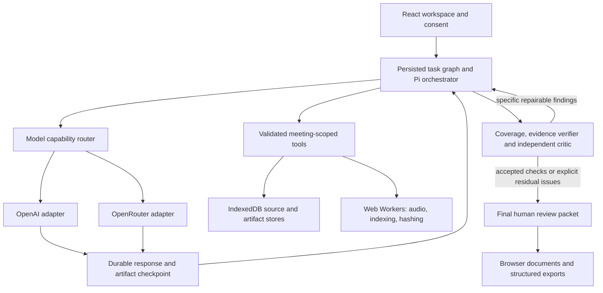

# Quality-first meeting intelligence plan

Date: 2026-11-17. Owner direction: **Pi-Orchestrated, Multi-Model, Evidence-Grounded Meeting Intelligence Platform**.

Status: approved product direction; phased engineering plan. This document does not claim that the proposed orchestration, model router, independent review, or quality thresholds are implemented or measured. Baseline source audit: `d53ab1cfa4acb48f6a2b9aa81075bf3f8f097b13`. The six-request defect was reproduced locally against that build with synthetic provider responses. QF01 and UI-TOKEN follow-up implementation evidence belongs in [VALIDATION.md](VALIDATION.md); the audit table below deliberately preserves the pre-change baseline.

## 1. Operating principles

| Principle | Required behavior |
| --- | --- |
| LLM-first | Use LLMs for contextual understanding, reasoning, analysis, semantic verification and writing. Deterministic code owns permissions, persistence, source identity and contract enforcement. |
| Pi-first | Pi is the workflow orchestrator, not a single-prompt wrapper. Use the browser-compatible core and explicit adapters; do not assume the CLI can run unchanged in a PWA. |
| Browser-first | React/TypeScript, IndexedDB, Web APIs and Web Workers form the primary runtime. Authorized external providers supply model computation when needed. No mandatory companion or application backend. |
| Multi-model | Route stages through OpenAI and OpenRouter according to verified capability and measured task performance. Different providers routing to the same underlying model do not establish independent review. |
| Quality-first | Optimize accuracy, important-fact completeness, evidence fidelity, calibrated uncertainty and useful output. A valid JSON response or a polished memo is insufficient. |
| Multi-pass | Plan, read, analyze, verify, critique, repair and verify again when unresolved quality issues justify it. Preserve every useful checkpoint. |
| No cost optimization | Do not select weaker reasoning, omit context, skip necessary review, or stop at an arbitrary cumulative request count to save money. Usage remains observable, not an optimization objective. |
| Human at the end | After initial data/provider consent, automate the normal analysis and revision workflow. The final human reviews evidence and residual uncertainties; they should not have to manage routine chunks or agent handoffs. |

No cost optimization does not authorize meaningless repeats, automatic resubmission of unknown outcomes, or unlimited resource consumption. Keep BYOK disclosure and initial confirmation. Pause only for a concrete unresolved dependency, safety/correctness failure, resource boundary or lack of progress, not because a fixed number of useful LLM turns has occurred. No new paid experiment or private-data upload was performed to write this plan.

## 2. Current code audit and production verdict

The current product is an implemented browser beta, not an accepted production meeting-intelligence system. It has substantial local review, provenance, revision, PWA and mocked-provider coverage. It lacks the real-data evidence needed to make accuracy or NotebookLM-parity claims. Do not turn checklist completion into a production-readiness percentage.

| Area | Evidence in current source | Production gap / priority |
| --- | --- | --- |
| Browser agent | `src/jobs/memo-agent.ts` imports `Agent` from pinned `@earendil-works/pi-agent-core` 1.5.2 and the specific `pi-ai/api/openai-responses` transport after confirmation. Two local tools, durable receipts, Web Lock and revision checks exist. | Pi remains an optional selective mode tied to OpenAI `gpt-6-luna`; no task graph, role scheduler, capability router or independent critic. P0/P1. |
| Ordinary notes | `src/providers/api.ts`, `memo-input.ts`, `memo-plan.ts`, `src/jobs/memo-pipeline.ts`: structured notes, lossless transport groups, extraction checkpoints and synthesis. | 80,000 serialized characters/request, at most eight extraction chunks, output/item/citation ceilings and no semantic quality loop. Rewrite decomposition rather than silently truncating or just increasing constants. P1. |
| Selective review limits | `memo-agent-contract.ts`, `model.ts`, `memo-agent-plan.ts`, `memo-agent.ts` jointly impose six requests and 32 cumulative lookups in the audited baseline. UI hides continuation after the limit. | Local Chromium reproduced six saved valid turns followed by the reported refusal. Remove cumulative cost-oriented ceilings across persistence, UI, execution and legacy resume. P0, QF01. |
| Reasoning and model choice | The original audit found hardcoded low reasoning, 4,096 output tokens and one transport. The QF03 manual-route slice now persists explicit OpenAI/OpenRouter routes and exposes reasoning/output parameters; both routes use the same Luna model and have no measured quality promotion. Settings select a provider/model for speech and memo, not per role. | Profile stages using measured reasoning/output needs; do not assume a more expensive or larger-context model is automatically better. P1, QF03. |
| Transcript and speakers | Immutable provider runs, original/current source revisions, speaker edits, undo, acoustic workers and matching checkpoints exist. See `HANDOFF.md` and `src/domain/acoustic-speaker.ts`. | Real speaker matching accuracy remains unmeasured; mixed-voice labels, threshold calibration and model-licence follow-up remain. LLM names/text cannot establish voice identity. P0/P1. |
| Evidence | `normalizeMemo`, revision references, cited-passage viewer, original generated items and pending human review exist. Pi requires IDs actually returned by range reads. | Valid IDs and a partly read passage do not prove full support, context coverage or lack of omitted facts. No independent semantic verifier. P0/P1. |
| Recovery | Intent before POST, saved responses, local-only receipt recovery, no automatic paid retry, export and source revision checks exist. | Whole meeting JSON is capped at 64 MiB; aggregate rewriting, 400 job ledger entries and in-memory unsaved receipts constrain long workflows. Chunked backup/reattachment gaps REC01–03 remain P0. |
| Quality evaluation | `evaluate-citation-annotations.mjs`, `evaluate-speech-annotations.mjs`, voice replay and synthetic tests exist. | Synthetic arithmetic fixtures are not production accuracy. No representative frozen real-meeting set or independent omission/adjudication benchmark. P0, QF02. |
| Delivery | Static Pages, namespaced service worker/storage, offline editing, draft-safe updates, browser tests and shared UI components exist. | Physical iOS/Android, screen readers, suspension/quota, sensitive-origin isolation and real-provider compatibility gates remain. P0/P1. |
| UX | Meeting notes, evidence links, processing history and responsive controls exist. | Need stage/issue/source coverage views, final review packet and token consistency across all surfaces. P1. |

The audit covered execution, schema, provider selection, prompts, storage/recovery, evaluation scripts, tests and documented open gates. It was not an exhaustive security audit of every source line or dependency.

## 3. NotebookLM comparison: evidence, not assumed internals

Official Google pages were reviewed on 2026-11-17; some pages now use the name Gemini Notebook. This comparison uses documented observable behavior only. We did not run a side-by-side account benchmark or inspect Google's private orchestration, model prompts, storage or accuracy.

| Capability | Officially documented reference | This PWA and target |
| --- | --- | --- |
| Source-grounded questions | Select sources, inspect quoted evidence and open citations in context. [Google chat](https://support.google.com/gemininotebook/answer/16179559?hl=en) | Existing source links are a foundation. Add claim-level entailment checks, important-fact recall, inspectable disagreements and revision-bound verification. |
| Source ingestion | Documents, audio and other source types; audio is transcribed into a source; source-size and format restrictions exist. [Google sources](https://support.google.com/gemininotebook/answer/16215270?hl=en) | Focus first on reliable original audio/transcript recovery, then consented meeting attachments and stable source manifests. Do not copy source limits as our engineering limits. |
| Multiple artifacts | Notes, reports and other outputs organized around a notebook. [Google notebook](https://support.google.com/gemininotebook/answer/16206563?hl=en) | Prioritize meeting-specific executive memo, decision log, action register, unresolved questions and evidence packet. Broader presentation formats are later. |
| Source revision behavior | Source updates need not rewrite existing Studio outputs. [Google sources](https://support.google.com/gemininotebook/answer/16215270?hl=en) | Retain immutable generation inputs and explicitly invalidate affected conclusions. Preserve reviewed versions and show corrections as proposals. |
| Agentic interaction | Current help describes actions, artifacts and inspectable task activity. [Google chat](https://support.google.com/gemininotebook/answer/16179559?hl=en) | Build an application-owned task graph with restricted tools and observable stages, not a copy of unverified backend behavior. |
| Quality parity | Public feature descriptions do not provide a comparable accuracy score. | Use consented identical inputs, blinded scoring and recorded settings before any parity/superiority claim. NotebookLM is a reference experience, not ground truth. |

Our intended differentiation is meeting-specific speaker continuity, immutable original transcript and evidence revisions, BYOK provider choice, recoverable local ownership, explicit decision/action semantics and transparent quality findings. These are targets, not proven advantages.

## 4. Browser architecture and Pi boundary

### Verified runtime versus planned integration

The installed core package exports a general-purpose `Agent`, state management, tools and transport abstraction. The current app uses these under its CSP, with sequential tools and a custom fetch boundary; it does not import a coding-agent CLI, spawn shell processes or expose a filesystem. Package Node engine metadata alone is not browser certification. Existing Chromium/WebKit tests cover the explicit core/Responses adapter, not every Pi provider, extension or Node environment-discovery path.

Keep a small application adapter around the pinned core. Verify each provider adapter in an isolated browser bundle before routing production stages through it. Do not add generic environment discovery, CLI plugins, Node shims, `eval`, unrestricted network tools or arbitrary generated code execution. If future code-generated artifact tools are needed, specify a separate restricted Worker/WASM contract, provenance and tests; they are not part of the initial permission set.

CPU-heavy indexing, decoding, waveform preparation and hashing belong in cancellable Workers with bounded buffers. Orchestration and provider I/O may remain on the main thread initially if responsive; moving them to a Worker does not establish persistent background execution. IndexedDB checkpoints survive page termination; an active request may not. Service workers cache the shell and coordinate updates, not run indefinitely or cache keys/provider payloads.

### Tool permissions

| Tool family | Inputs and outputs | Permission |
| --- | --- | --- |
| Source manifest / paged read | Meeting, frozen source revision, exact ranges; return text and next cursor | Read-only, meeting scoped; validate every argument and reference |
| Search / topic retrieval | Query, approved local indexes, source filters; return candidates and source references | Search snippets are leads; retrieve actual evidence before citing |
| Audio context / speech analysis | User-approved recording ranges and a declared provider route | No silent recording upload, cross-meeting search or identity inference |
| Stage artifacts / issue registration | Typed claims, evidence, contradictions, coverage and revision patches | Append-only artifacts; cannot overwrite original/human-confirmed data |
| Quality validation | Candidate artifact and frozen evidence | Deterministic validators plus provider-routed semantic review |
| Final proposal / export | Validated artifact version, approval metadata | New version only; local export; external messaging/sharing out of scope |

The LLM proposes tool calls and stage transitions. Deterministic code validates permissions, hashes, task dependencies and persistence. The model cannot declare its own output accepted, alter a key, bypass a pending receipt, or invent a completed stage.

## 5. Logical roles and task graph

These are logical roles. A simple meeting need not start eight simultaneous agents. Pi chooses sequential or bounded parallel execution based on dependencies, context and actual resource/provider capability, not price. Parallel roles read frozen inputs and append separate artifacts; a single transactional coordinator owns meeting/version changes.

| Role | Responsibility | Required artifact / constraints |
| --- | --- | --- |
| Transcript Analyst | Detect missing chunks, language switches, uncertain names/numbers, timing gaps and contextual discontinuity | Coverage ledger and correction proposals tied to source/audio; never rewrite the original transcript |
| Speaker Analyst | Check attribution continuity, overlap and contradictory assignments | Acoustic/provider evidence, ambiguity and proposed mapping; names/semantic similarity alone never establish identity |
| Meeting Analyst | Build agenda, topic map, chronology and dependencies across the entire meeting | Topic facts and exact source ranges, including beginning/middle/end and reopened topics |
| Decision Analyst | Distinguish suggestions, rejected options, decisions, conditions, commitments and later reversals | Decision lifecycle with supporting/revising/contradicting references |
| Action Analyst | Extract task, owner, commitment, due date and dependencies | Action records with field-level evidence; unknown owner/date stays unknown |
| Evidence Verifier | Check every material claim against exact cited text and necessary surrounding context | Supported / partial / unsupported / indeterminate, reasons, missing evidence and counterevidence |
| Critical Reviewer | Independently search for omissions, contradictions, unsupported certainty and hallucinations | Issue ledger, assessed scope and source facts missing from the candidate |
| Memo Editor | Produce clear, useful, structured final notes and incorporate accepted repairs | Executive summary, topic notes, decision log, action register, risks/questions and linked evidence |

Sequence:

1. Freeze source manifest, settings, consented recipients, selected capability profile and human-confirmed facts.
2. Ingest/validate all source chunks. Record missing or failed inputs; never pretend the available prefix is the complete recording.
3. Transcript/Speaker analysis produces source-quality findings and a versioned working projection. Uncertain identity stays anonymous and does not block all useful analysis.
4. Enumerate full-source coverage units; analyze all units with overlap and persistent evidence. Derive the topic map from the source, not only early summaries.
5. Run Meeting/Decision/Action analysis; dependent roles use complete topic artifacts plus retrievable original evidence. Independent topic jobs may run concurrently.
6. Generate a candidate, then verify atomic claims and separately audit omissions from source facts. Critical review uses a fresh context without the author's self-score or persuasive reasoning. Prefer a genuinely different model family or deterministic/independent method when supported.
7. Pi classifies findings, retrieves missing evidence and repairs affected artifacts. Re-run the impacted verifier and any downstream checks; do not rerun unaffected transcription or accepted stages.
8. Finish only when required checks are completed or explicit non-repairable findings remain. Present residual issues and coverage as such; human acceptance is separate from AI completion.

LLM reviewers are fallible. Agreement between models is a signal, not proof. Disagreement triggers evidence inspection, not majority voting. No private chain-of-thought is required for audit: store concise decisions, evidence, issue reasons, model/settings and outcomes.

## 6. Model capability router

Create a versioned registry, not a hardcoded model per application. Required profile fields: provider, exact model/version, upstream route where reported, supported modalities/languages, diarization/timestamps, tools/JSON/streaming behavior, reasoning controls, measured context/output envelope, browser CORS/CSP result, retention/data destinations, account access, benchmark version/result and verification date. Treat unknown capability as unknown. Model lists and SDK types alone cannot make a route production-eligible.

| Workload | Selection evidence |
| --- | --- |
| Transcription | Lowest relevant WER/CER and important number/name error rates, speaker confusion, overlap/timing quality and long-recording boundary behavior on representative audio |
| Deep reasoning | Decision-versus-proposal distinction, contradictions, conditions, revisions, causal reasoning and action extraction against human references |
| Long context | Measured important-fact recall across source positions and lengths, valid output and ability to recover original evidence; theoretical window size is insufficient |
| Independent verification | Unsupported-claim detection precision/recall and false accusations; independent method/model lineage and fresh context |
| Final writing | Factual retention, field accuracy, structural usefulness, concise language and human correction time; formatting must not change approved facts |

Routing algorithm: filter by consent, keys/access, required capabilities and browser compatibility; rank eligible routes on the frozen task benchmark and uncertainty; use an explicit quality profile per stage. Do not include a price-minimization term. Use stronger reasoning or additional context where the task evidence supports it. Reserve measured output capacity so reasoning does not consume all visible-output capacity. Persist exact routing decisions. Missing eligible routes are a visible blocker or limited mode, never a silent downgrade to an unverified weaker model.

OpenRouter supports client tool calling but model/provider compatibility must be checked. Preserve provider-specific reasoning/signatures when required by the selected adapter. See [OpenRouter tools](https://openrouter.ai/docs/guides/features/tool-calling) and [reasoning controls](https://openrouter.ai/docs/guides/best-practices/reasoning-tokens). The two-provider ordinary memo path already exists; the Pi OpenRouter adapter and role router remain to be implemented and tested. Cross-provider fallbacks must remain within the originally approved destination set. Unknown outcomes are never a fallback trigger for a duplicate submission.

## 7. Long meetings and evidence data model

A long-context model helps but does not replace coverage accounting. Use a complete immutable source manifest and paginated source/evidence stores. Partition by speaker turn and topic with boundary overlap; preserve original IDs, offsets, timestamps and revisions. Every source interval must be assigned, processed, explicitly unavailable, or deliberately excluded with a visible reason.

Planned artifacts:

- `SourceManifest`: recording content identity, chunk checksums, transcript versions, original/provider run and missing intervals.
- `CoverageUnit`: exact source intervals, input hash, analyzed stage/version, complete/partial/unavailable and next cursor. Count characters/time where known; a touched passage is not fully read.
- `Claim`: atomic statement, type, conditions, speaker attribution, field-level evidence and status.
- `Decision` / `Action`: lifecycle, owner/date evidence, dependencies and superseding references.
- `QualityIssue`: category, severity, affected claim/source, evidence, proposed remedy, resolved-by artifact and remaining uncertainty.
- `StageArtifact`: task/run/role, model parameters, source and prompt hashes, raw response reference, validated output and generation version.
- `ProtectedFact`: human-confirmed fact/version and evidence; subsequent AI edits are proposals requiring an explicit diff, never silent mutation.

Do not build a lossy summary-of-summaries pipeline. Carry a fact/evidence index through hierarchical synthesis, audit omitted important facts against the source map, and re-read original passages for final verification. When context is full, compact *working context* with artifact pointers and resumable retrieval; preserve original transcripts, complete responses and citations separately. When output is too long, write sections and combine validated artifacts. No silent input/output truncation.

The current 64 MiB aggregate, 400-job schema and whole-archive backup remain technical boundaries. Replace them with paginated source, run, response, artifact and issue stores; use additive IndexedDB migration with a checkpoint journal and atomic manifest publication. Old data remains readable until migration verification completes. Crash/reload resumes migration idempotently; quota failure keeps original data. Garbage collection is separate and reference-aware, never a side effect of a generation failure. Export manifests include checksums and format versions; streaming/bounded imports verify entries before creating a restored copy. REC01–03 must be closed for long-recording production claims.

## 8. Quality-driven continuation and recovery

Remove fixed cumulative request and lookup budgets. A run stops for one of these explicit reasons:

- Required coverage, semantic checks, citation checks and output contracts pass: ready for final human review.
- A specific non-repairable source ambiguity remains: limited result with issue list, not an invented fact.
- Identical lookups/results, repeated invalid tools or unchanged repair attempts make no progress: pause with saved evidence and actionable diagnosis.
- Request outcome unknown, unsaved response, invalid source revision, lost lock or actual storage/context/provider boundary: checkpoint and recover safely.
- User cancel: stop local scheduling immediately; disclose that an already submitted request may still complete remotely.

Anti-loop identity includes stage, source revision, normalized inputs, issue/artifact version and provider/model. A justified revision is a new task with a documented quality purpose; replaying the same unknown request is not. No-progress heuristics protect execution; they are not quality scores or arbitrary ceilings on useful work.

State model: `planned → ready → running → response_saved → validated → completed`, with `paused`, `outcome_unknown`, `blocked`, `stale` and `failed` carrying explicit reasons. Persist a request intent before sending, raw/sanitized response before any dependent request, and validated artifacts before task completion. Recover from the last durable stage. Reload never submits a request by itself. Known completed responses may be re-parsed locally without contacting a provider. Verified provider polling/retrieval may reconcile an existing request; it must not silently create a new one.

Initial consent covers the defined multi-stage workflow, allowed models/providers, data types and possibility of additional necessary analysis. Successful stages proceed without repeated human approval. Uncertain billing/data outcomes remain a deliberate recovery exception. Local-save retry is local only. Rate-limit/server/network failures use explicit recovery unless a documented operation is proven not submitted; SDK retries remain disabled at the paid POST boundary. Do not fabricate an idempotency guarantee that a provider does not offer.

Immediate QF01 design: new selective plans use no fixed cumulative cap; legacy six-request plans remain importable and upgrade only when explicitly continued; more than six useful responses and more than 32 total tools must complete. Keep bounded tool *bursts*, byte/storage checks, duplicate call-ID validation and a no-progress pause. Existing records and human edits survive. This unblocks the present defect; it does not by itself implement this document's full quality workflow.

## 9. Final user experience and export

Show a concise stage timeline: source preparation, transcript/speaker analysis, topic/decision/action analysis, evidence verification, critical review, revision and final assembly. Display completed/total coverage units when the denominator is known; show indeterminate activity otherwise. A changing task graph must not pretend to be a linear percentage.

Each stage exposes concise findings, provider/model, completion state and recoverable errors. Keep raw records and technical details expandable. The final packet contains memo, decision/action registers, source coverage, unresolved issues, model/stage provenance, original transcript access and clickable revision-bound evidence with audio where available. Human review may accept, correct or reject; corrections invalidate only dependent claims/checks and trigger targeted AI proposals. Initial data consent remains, routine intermediate management does not.

Browser exports: Markdown/TXT/JSON initially, validated printable document and optional additional formats later. Export evidence and provenance, not a document that looks finalized while hiding open issues. Backups preserve originals, human edits, complete checkpoint graphs and restorable local artifacts, excluding keys. External sharing/collaboration requires separate authentication and authorization architecture.

UI follows the existing shared components, semantic color tokens and Masonry card-collection SSOT. State meaning must survive theme changes and not depend on color alone. Implement keyboard, zoom, screen-reader and phone-safe-area behavior alongside each new control.

## 10. Quality evaluation and production gates

[QUALITY-EVALUATION.md](QUALITY-EVALUATION.md) defines the proposed benchmark, metrics, thresholds and evidence record. The existing synthetic evaluation scripts are reused where compatible; they do not supply real reference data or omission scoring automatically.

Release requires all applicable gates: source/recovery integrity; browser-compatible Pi and both provider routes; independently annotated real-meeting quality; actual authorized provider runs; browser E2E and physical devices; accessibility; security/privacy and licence constraints. A deployed SHA, green mocks, LLM self-score and human benchmark are separate evidence.

Cost and token usage remain in the trace for transparency and diagnosing truncation, but do not determine quality acceptance or reduce the number of needed stages. Historical paid-test reservations in older documents are historical, not the new product's optimization target. Private data and actual account access still require authorized evaluation inputs; do not use production keys or recordings opportunistically.

## 11. Sequenced implementation and acceptance

| ID / priority | Delivery | Dependencies | Observable acceptance |
| --- | --- | --- | --- |
| QF01 / P0 | Remove cumulative six-request/32-tool limits; retain recovery and progress guards | Existing Pi integration | >6 requests and >32 cumulative tools; old checkpoint resume, reload-no-send, backup and all failure cases pass in both engines |
| QF02 / P0 | Frozen quality set, annotation schema, omission/decision/action scoring and benchmark runner | Consented representative data; independent annotations | Baseline published as measurements with denominators, unknowns and confidence intervals; no synthetic-as-real claim |
| QF03 / P1 | Capability registry and OpenAI/OpenRouter Pi adapters | QF01, QF02 | Real CORS/tool/JSON/reasoning/account checks for eligible routes; no retries or silent destination/model changes |
| QF04 / P0 | Paginated artifacts/task graph, request intent and response journal, migration/backup | QF01; REC01–03 recovery contracts | Crash/quota/reload/multi-tab/old-backup tests retain data; completed requests never resubmitted |
| QF05 / P1 | Full-source coverage, turn/topic partitioning and fact index | QF04 | All intervals accounted for; beginning/middle/end gold facts preserved across context splits; no silent truncation |
| QF06 / P1 | Eight logical roles, typed outputs and bounded parallel scheduling | QF03–05 | Decisions/actions/attribution match evidence; dependency and cancellation tests; no concurrent aggregate overwrite |
| QF07 / P1 | Independent verifier, critic and targeted repair | QF02, QF06 | Seeded unsupported claims and omissions detected; fresh reviewer context; protected facts and prior versions unchanged |
| QF08 / P1 | Quality profile, stronger reasoning where warranted and model routing benchmark | QF02–03, QF07 | Candidate improves measured protected metrics; same underlying model not mislabeled independent |
| QF09 / P1 | Stage/issue UI, final review packet and browser exports | QF04–07 | End-to-end generation needs only initial consent and final review in normal flow; issue visibility, source navigation and accessible export |
| QF10 / P0 release gate | Real-provider/device/quality acceptance and staged rollout | QF01–09; REC/VID/REL gates | Exact build, real recordings, human references and all applicable release gates; revert code without destroying migrated data |
| UI-TOKEN / P1 | Screenshot-reported residual theme roles | Shared theme/component contract | Settings notice, filters, timestamps and immersive controls follow the selected palette in light/dark; status roles remain semantic |

Implementation order: unblock QF01 and complete documentation; establish QF02 and storage/recovery foundations; adapters/router; full-coverage analysis; independent quality loop; final review UX; real acceptance. UI-TOKEN is a separate focused delivery. The existing standard memo flow remains available while the new primary Pi workflow earns acceptance. Do not remove a working path before equivalent recovery and quality gates pass.

No invented calendar dates: task duration depends on available real recordings, account/device access and baseline findings. Engineering can proceed on synthetic contracts while real-evaluation dependencies are collected, but production-quality acceptance stays open. Track QF01–QF10 as ten distinct deliverables in `task.md`; UI-TOKEN, historical tasks and REC/VID dependencies are not extra percentage credit inside that denominator.

## 12. Documentation ownership

- [../goal.md](../goal.md): owner direction, principles and definition of done.
- This plan: architecture, audited gap register, role/model strategy and phased implementation SSOT.
- [QUALITY-EVALUATION.md](QUALITY-EVALUATION.md): reference data, metrics, release-quality gates and benchmark procedure.
- [../task.md](../task.md): independently checkable execution tasks; mark complete only with evidence.
- [../FEATURES_MAP.md](../FEATURES_MAP.md): current implemented modules versus planned additions.
- [PRODUCT.md](PRODUCT.md), [ARCHITECTURE.md](ARCHITECTURE.md), [PI-MEMO-READINESS.md](PI-MEMO-READINESS.md): shipped requirements/contracts, updated as phases land.
- [VALIDATION.md](VALIDATION.md): actual commands/results, build identity, failures and untested boundaries.
- [RELEASE-ACCEPTANCE.md](RELEASE-ACCEPTANCE.md): real provider/device/user acceptance.

Changes to models, prompts, orchestration, evidence projection or quality criteria must update their version/provenance and rerun the affected frozen benchmark. Documentation acceptance is not product completion.
